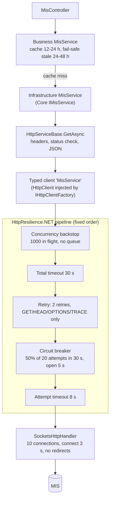
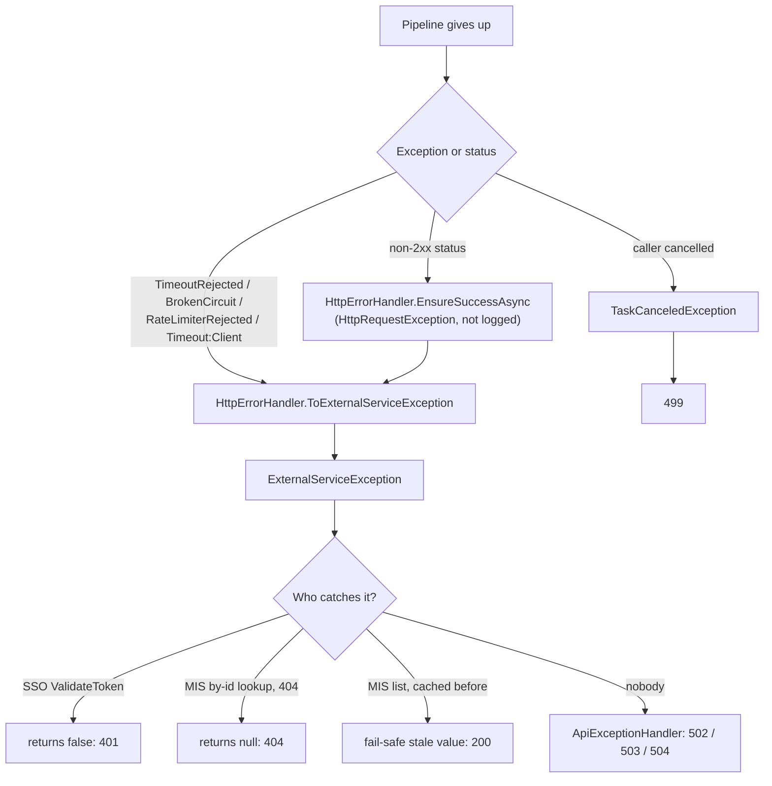
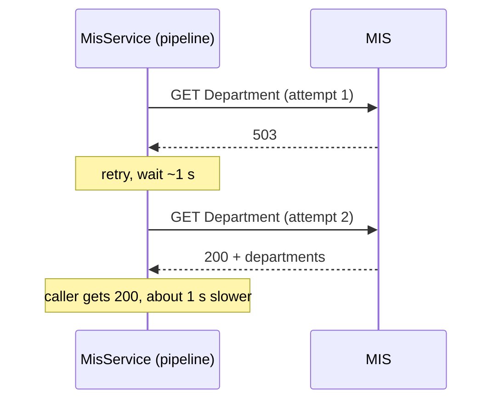
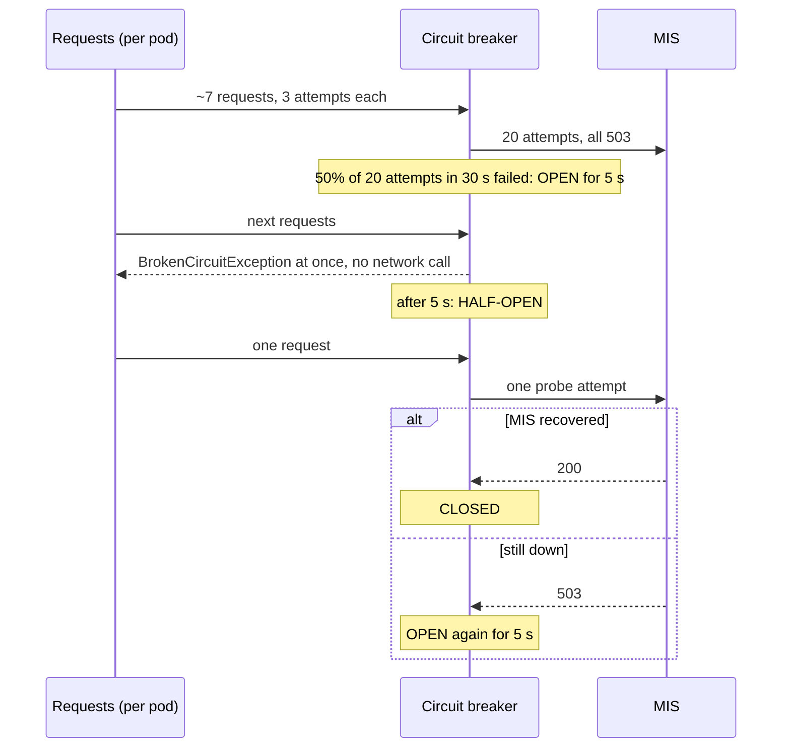
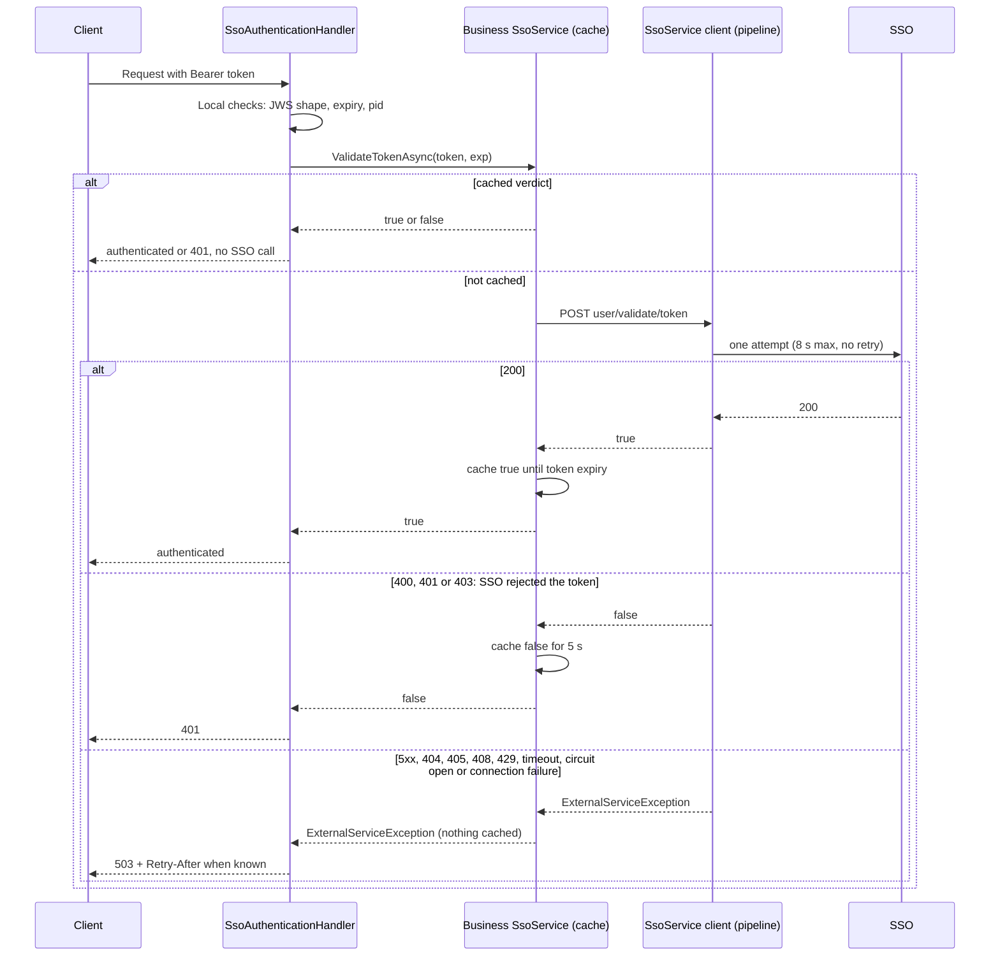

# Resilience Patterns Guide

[← Back to README](../README.md)

## Table of Contents

- [Overview](#overview)
- [Call Path and Pipeline](#call-path-and-pipeline)
- [Registration and Startup](#registration-and-startup)
- [Configuration](#configuration)
- [What Counts as a Failure](#what-counts-as-a-failure)
- [Exceptions Callers See](#exceptions-callers-see)
- [MIS Scenarios](#mis-scenarios)
- [SSO Scenarios](#sso-scenarios)
- [ASM Scenarios](#asm-scenarios)
- [Timing Budget](#timing-budget)
- [Telemetry](#telemetry)
- [Testing](#testing)
- [Troubleshooting](#troubleshooting)
- [Related Documentation](#related-documentation)

---

## Overview

Outbound HTTP resilience (SSO, MIS, ASM) comes from the internal **HttpResilience.NET** package (`baps-apps-packages` feed, mapped in `nuget.config`). It configures `Microsoft.Extensions.Http.Resilience` and Polly 8 from one validated `HttpResilience` configuration section, with a fixed pipeline order and safe defaults. The project owns no retry, timeout, circuit-breaker or connection-pool code. This guide covers how it is wired, how it is configured, and what happens in practice when SSO, MIS or ASM misbehave.

The package validates at host start: an unknown key, an out-of-range value, a `Clients:{name}` section no client reads, or a client whose handler chain cannot be built fails startup and names the key. This project uses HttpResilience.NET 3.1.0. Full key reference: [HttpResilience.NET CONFIGURATION.md](https://github.com/baps-apps/http-resilience-net/blob/main/docs/CONFIGURATION.md).

## Call Path and Pipeline

A request to a MIS-backed endpoint, from controller to MIS and back. SSO and ASM use the same pipeline with the same numbers.



`Timeout:Client` (`HttpClient.Timeout`, 60 s) sits outside the whole pipeline and also bounds reading the response body. `Timeout:Total` and `Timeout:Attempt` stop applying once response headers arrive.

| Layer | File | Role |
| --- | --- | --- |
| Registration | `Infrastructure/Extensions/HttpClientRegistrationExtensions.cs` | `AddHttpResilience`, one `AddHttpResilienceHandler()` per client, 10 MB response cap |
| HTTP base | `Infrastructure/Helpers/HttpServiceBase.cs` | Sends, checks status, deserializes |
| Error mapping | `Infrastructure/Helpers/HttpErrorHandler.cs` | Turns outbound failures into `ExternalServiceException` (`HttpResilienceFailure.Classify`) |
| Callers | `Business/Services/{Sso,Mis,Asm}Service.cs` (caching), `Api/Authentication/SsoAuthenticationHandler.cs` (401/503/500 decision) | Caching, auth decisions |

## Registration and Startup

`HttpClientRegistrationExtensions.AddInfrastructureHttpClients` (Infrastructure), abridged: the real code registers each client through its private `RegisterHttpClient` helper:

```csharp
services.AddHttpResilience(configuration);   // reads "HttpResilience"
services.AddHttpResilienceTelemetry();       // adds error.type on exception outcomes

// Typed client under an explicit name, so it reads Clients:MisService (not Clients:IMisService)
services.AddHttpClient<IMisService, MisService>("MisService", (sp, client) =>
{
    client.MaxResponseContentBufferSize = MaxResponseBytes;   // 10 MB
    // base address (SSRF-validated) and AuthAppId/AuthAppSecret headers
})
.AddHttpResilienceHandler();   // reads HttpResilience:Clients:MisService, else the root
```

Why typed clients, and the rules that come with them (transient lifetime, never in a singleton, no `client.Timeout` in the constructor): [HttpClient Factory Guide](../guides/httpclient-factory.md#gss-client-model).

At host start the package:

1. Validates every key, failing startup with the key's name on a typo, an out-of-range value or `Attempt` ≥ `Total`.
2. Builds all three clients once, so a broken handler chain fails the deployment, not the first request.
3. Logs, per client, event 15 (effective settings) and event 11 (the traffic its breaker needs before it can open).

```text
info: HttpResilience.NET.Configuration[15]
      HttpResilience client 'MisService' uses the standard pipeline: <summary of the effective settings>.
```

Do not add any of these to a client that has `AddHttpResilienceHandler()`:

| Don't | Why |
| --- | --- |
| `AddStandardResilienceHandler()` / `AddStandardHedgingHandler()` | Nests a second pipeline (the package README counts 9 origin calls instead of 3) or fails client creation. |
| `AddPolicyHandler` / `AddTransientHttpErrorPolicy` (Polly v7) | Nests and retries POST. |
| `client.Timeout = ...` | `Timeout:Client` owns `HttpClient.Timeout`; a different value fails client creation. |
| `ConfigurePrimaryHttpMessageHandler(new SocketsHttpHandler { ... })` with pool settings | `Connection` overwrites its connect timeout, idle timeout and lifetime. A primary handler that is not a `SocketsHttpHandler` fails client creation. |
| `SetHandlerLifetime(...)` (finite) | `Connection:Enabled` turns factory rotation off; `PooledConnectionLifetime` bounds DNS staleness. |

For a strategy the schema lacks, add it **after** the package's handler: `.AddHttpResilienceHandler().AddResilienceHandler("extra", p => ...)`.

## Configuration

`src/GSS.Api/appsettings.json` states only what differs from the package defaults:

```json
"HttpResilience": {
  "Timeout": { "Total": "00:00:30", "Attempt": "00:00:08" },
  "Retry": { "BaseDelay": "00:00:01" },
  "Connection": { "Enabled": true, "MaxConnectionsPerServer": 10, "AllowAutoRedirect": false }
}
```

Effective settings for every client (logged at startup as event 15):

| Setting | Value | Why |
| --- | --- | --- |
| `Timeout:Total` | 30 s | One deadline for the call, retries included. |
| `Timeout:Attempt` | 8 s | Fits the retry schedule: 3 attempts × 8 s + 1 s + 2 s backoff = 27 s ≤ 30 s. |
| `Timeout:Client` | 60 s (default `Total` + 30 s) | Backstop that also covers the response body. |
| `Retry:MaxRetries` | 2 (default) | 3 requests in total. |
| `Retry:BaseDelay` | 1 s, exponential with jitter, each wait capped at 5 s (`MaxDelay`) | Dependencies are cross-network, not same-cluster. |
| `Retry:UseRetryAfterHeader` | on (default) | A `Retry-After` up to 5 s replaces the backoff; a longer one ends retries. |
| `CircuitBreaker` | defaults: opens at 50% of ≥ 20 attempts in 30 s, for 5 s | Counted per pod, in attempts. |
| `ConcurrencyLimiter:Backstop` | 1000 (default) | Above it, requests are rejected at once. |
| `Connection:MaxConnectionsPerServer` | 10 | |
| `Connection:ConnectTimeout` | 3 s (default) | TCP + TLS. |
| `Connection:PooledConnectionLifetime` / `IdleTimeout` | 2 min / 1 min (defaults) | Bounds DNS staleness; factory handler rotation is off. |
| `Connection:AllowAutoRedirect` | `false` | A followed redirect re-sends MIS/ASM `AuthAppId`/`AuthAppSecret` headers to the new host. |

Response **size** is not a resilience setting: each client caps buffered responses at 10 MB with `MaxResponseContentBufferSize` (see [HttpClient Factory Guide](../guides/httpclient-factory.md#registration-and-configuration)).

Per-client overrides go under `HttpResilience:Clients:{SsoService|MisService|AsmService}`; a client states only the keys it changes:

```json
"HttpResilience": {
  "Clients": {
    "MisService": { "Timeout": { "Total": "00:00:15", "Attempt": "00:00:04" } }
  }
}
```

Environment variables follow the usual form, for example `HttpResilience__Clients__MisService__Timeout__Total=00:00:15`.

Rules checked at startup: `Attempt` < `Total` < `Client`; `CircuitBreaker:SamplingDuration` ≥ 2 × `Attempt`; `Connection:ConnectTimeout` < `Attempt`. A retry schedule longer than `Total` logs Warning event 14.

Switches (restart required, configuration is read once):

- `HttpResilience:Enabled: false`: kill switch, every client runs without the pipeline.
- `HttpResilience:Clients:{name}:Enabled: false`: one client off.
- `HttpResilience:Retry:Enabled: false`: retries off (`MaxRetries` cannot be 0).

## What Counts as a Failure

| Outcome from the dependency | Retried? (GET only) | Counts toward the breaker? |
| --- | --- | --- |
| Connection refused, DNS failure, TLS failure | Yes | Yes |
| Attempt timeout (8 s, no response headers) | Yes | Yes |
| 500, 502, 503, 504 | Yes | Yes |
| 408 Request Timeout, 429 Too Many Requests | Yes | Yes |
| 400, 401, 403, 404 and other 4xx | No | No |
| 2xx | No | No (success) |

**Only GET, HEAD, OPTIONS and TRACE are retried.** A POST is never retried, whatever the outcome; it still has the timeouts and the breaker. All three SSO calls are POST (see [SSO Scenarios](#sso-scenarios)).

## Exceptions Callers See

| Cause | Exception from the pipeline |
| --- | --- |
| `Timeout:Total` / `Timeout:Attempt` | `Polly.Timeout.TimeoutRejectedException` |
| `Timeout:Client` | `TaskCanceledException` (inner `TimeoutException`) |
| Circuit open | `Polly.CircuitBreaker.BrokenCircuitException` |
| Concurrency backstop full | `Polly.RateLimiting.RateLimiterRejectedException` |
| Non-2xx response (after retries) | none; `HttpErrorHandler` throws `HttpRequestException` with `StatusCode` |

`HttpServiceBase` passes each one to `HttpErrorHandler.ToExternalServiceException`, which reads its cause with HttpResilience.NET's `HttpResilienceFailure.Classify` and throws the Core `ExternalServiceException` (service name, `Failure`, upstream `StatusCode`, rate-limiter `RetryAfter`). A `Timeout:Client` timeout is `Timeout`, never mistaken for a caller cancellation. A malformed JSON body (`JsonException`) and a 2xx MIS/ASM envelope with no body or `succeeded: false` are also `ExternalServiceException` (`Failed`, 502). A caller cancellation or a bug propagates unchanged. Only Infrastructure sees Polly or HttpResilience.NET types (`DependencyTests.OnlyInfrastructure_UsesTheResilienceLibraries`).

| `ExternalServiceException.Failure` | Cause | `ApiExceptionHandler` |
| --- | --- | --- |
| `Timeout` | `Timeout:Attempt`, `Timeout:Total`, `Timeout:Client` | 504 |
| `Unavailable` | Circuit open, outbound limiter or backstop | 503 (+ `Retry-After` when the rate limiter gave one) |
| `Failed` | Non-2xx response, connection or protocol error, malformed body | 502 |



## MIS Scenarios

MIS calls are GET, so the full pipeline applies, including retries.

### Transient 503



### Sustained outage and the circuit breaker



### All MIS cases

| Scenario | What happens | Caller sees |
| --- | --- | --- |
| One 503 blip | Attempt 1 fails, ~1 s wait, attempt 2 succeeds | 200, ~1 s slower |
| MIS returns 503 continuously | 3 attempts (~3 s), then `ExternalServiceException` (`Failed`, 503). The Business cache serves the last list while it is within its fail-safe window (48 h for departments and role types, 24 h for roles; person positions have none) | 200 with stale data, or 502 |
| MIS hangs | 3 × 8 s attempt timeouts + ~3 s backoff ≈ 27 s, then `ExternalServiceException` (`Timeout`) | 200 with stale data, or 504 after ~27 s |
| Outage persists | Breaker opens after ~7 failing requests; calls fail instantly for 5 s, then one probe | Fast 503 (or stale cache); MIS is not hammered |
| 429 with `Retry-After: 2` | Waits 2 s and retries. A `Retry-After` above 5 s ends retries and returns the 429 | 200 later, or 502 |
| Role not found | A MIS 404 (or no matching item) is not retried; `GetRoleByIdAsync` returns null, cached 5 min. A department is looked up in the cached department list, with no MIS call | 404 |
| MIS answers 302 | Redirect not followed (the `AuthAppSecret` header would be re-sent to the new host); 3xx is non-success | 502 |
| Response body over 10 MB | `HttpClient` stops buffering at 10 MB (`HttpRequestException`, `Failed`); not retried | 502 |
| Headers fast, body trickles | `Timeout:Total` stops at headers; `Timeout:Client` (60 s) cuts the body read (`Timeout`) | 504 |
| Burst of concurrent calls | 10 connections per server; extra requests queue in the pool (inside the 8 s attempt timeout); above 1000 in flight, rejected immediately (`Unavailable`) | Slower, or 503 at extreme load |

## SSO Scenarios

`ValidateToken`, `RenewToken` and `Logout` are all **POST**, so SSO calls are **never retried**. They still get the 8 s attempt timeout and the breaker.

### Token validation flow



### All SSO cases

| Scenario | What happens | Caller sees |
| --- | --- | --- |
| Valid token, already cached | No SSO call | 200 |
| Valid token, SSO healthy | One POST, result cached for the token's remaining lifetime | 200 |
| Invalid token | SSO 400/401/403: not retried, not a breaker failure; the rejection is cached for 5 s | 401 |
| SSO returns 503 (or 5xx, 404, 405, 408, 429) | One attempt only (POST); `ExternalServiceException` propagates | **503** |
| SSO hangs | Attempt timeout at 8 s, no retry | 503 after ~8 s |
| SSO outage persists | Breaker opens after 20 failed attempts in 30 s; uncached tokens fail instantly for 5 s | 503 for uncached users; cached users unaffected |
| Logout or renew refused (400/401/403) | No retry; null/false | 401 |
| Logout or renew: SSO cannot answer | No retry; `ExternalServiceException` reaches `ApiExceptionHandler` | 502 / 503 / 504 |

Two things to know:

- **An SSO outage is 503, not 401.** Only an SSO 400/401/403 means "token invalid"; a 404/405 means a wrong URL or endpoint, so it is treated as an outage rather than logging every user out. On an outage the handler fails authentication with the `ExternalServiceException` and its challenge answers 503 (`Retry-After` when known), so clients don't discard a good token or send users to log in again. Access is still denied, nothing is cached, and `[AllowAnonymous]` endpoints are unaffected.
- To retry SSO POSTs, set the option below. It applies to **every** POST on the client, including logout and renew, so only do it if SSO tolerates duplicates. Startup then logs Warning event 10. Never set it at the root (startup fails).

```json
"HttpResilience": { "Clients": { "SsoService": { "Retry": { "RetryableMethods": [ "GET", "POST" ] } } } }
```

## ASM Scenarios

ASM's application-security call is a GET, so it behaves like MIS on the wire. The Business layer differs:

| Scenario | What happens | Caller sees |
| --- | --- | --- |
| Permissions cached for this token | No ASM call | Normal authorization result |
| Transient ASM 503 | Retried like MIS | Normal result, slightly slower |
| ASM down | Permissions are cached with `FailSafe = false`, so **stale permissions are never served**. ASM is called once per request (3 attempts at most); the `ExternalServiceException` propagates | 502 / 503 / 504, never allowed |

No Business service wraps a cache call in try/catch. Caching.NET already turns Redis, serialization and backplane failures into a miss (its `ThrowOn*` switches stay off, pinned by `ConfigurationFileTests.Caching_DegradesCacheFailuresInsteadOfThrowing`), so anything thrown from `GetOrSetAsync` is the factory's own failure. A catch-and-retry there would repeat the external call: that is how ASM was once called twice per failing request.

## Timing Budget

Worst case for a GET whose dependency hangs:

```text
attempt 1   8 s ──┐
backoff     ~1 s  │
attempt 2   8 s   │  ≈ 27 s  ≤  Timeout:Total 30 s   (retry schedule fits: no event 14)
backoff     ~2 s  │
attempt 3   8 s ──┘
```

For a POST (SSO) it is one attempt: 8 s at most. `Timeout:Client` (60 s) only fires if the body transfer stalls after headers arrive.

When tuning a client, keep `(1 + MaxRetries) × Attempt + backoff ≤ Total < Client` and `CircuitBreaker:SamplingDuration ≥ 2 × Attempt`. Load on a failing dependency is `replicas × RPS × (1 + MaxRetries)` until its breaker opens.

## Telemetry

OpenTelemetry.NET (2.7.0 or later; this project uses 2.9.0) registers the `Polly` and `HttpResilience.NET` meters unconditionally, so they do not belong in `OpenTelemetryOptions:Meters` (which lists only `ApiPipeline.NET` in `appsettings.json`). `AddHttpResilienceTelemetry()` adds the `error.type` tag.

| Signal | Where | Use |
| --- | --- | --- |
| Startup events 15, 11 | Log category `HttpResilience.NET.Configuration` | Confirm effective settings per client |
| Retry and breaker events | Log category `HttpResilience.NET.Pipeline` | Retry attempts, circuit breaker opened, half-open and closed |
| One span per attempt | Tracing (`System.Net.Http`) | A retried call shows several sibling HTTP spans |
| `http_resilience.circuit_breaker.state` | Meter `HttpResilience.NET` | Breaker state per client |
| Retry and attempt metrics | Meter `Polly` | Retry counts, attempt durations |

Alert on breaker state, never gate a health probe on it (an open breaker means the dependency is down, not this pod):

```text
http_resilience.circuit_breaker.state{http_resilience.circuit_breaker.state="open"} == 1
```

## Testing

- `WebAppFactory` starts the host, so every client is created and validated there.
- To stub an origin, add a `DelegatingHandler` **after** the resilience handler (it becomes the innermost handler, so the pipeline still runs):

  ```csharp
  builder.Services.AddHttpClient("MisService")   // same name as the typed client, so it configures it
      .AddHttpMessageHandler(() => new StubHandler(HttpStatusCode.ServiceUnavailable));
  ```

  Do not use `ConfigurePrimaryHttpMessageHandler`: with `Connection:Enabled` a non-`SocketsHttpHandler` primary fails client creation.
- A failing GET reaches the stub 3 times; a failing POST once. Assert those counts, or set `HttpResilience:Retry:Enabled: false` in test configuration.
- Caching is off in the development `appsettings.json` (`CacheOptions:Enabled: false`), so locally every request calls SSO, MIS and ASM and the stale-cache rows above do not apply.

## Troubleshooting

| Startup message | Fix |
| --- | --- |
| `unknown key. Expected ...` | Typo; use the key the message suggests. |
| `no registered HTTP client reads this section` | `Clients:{name}` must match the client name (`SsoService`, `MisService`, `AsmService`). |
| `Retry:MaxAttempts` | Use `Retry:MaxRetries` (retries after the first attempt). |
| `MaxRetries` 0 out of range | Use `Retry:Enabled: false`. |
| Event 14 (Warning) | Retry schedule outlasts `Timeout:Total`; lower `Attempt`/`MaxRetries` or raise `Total`. |
| Event 12 (Information) / 20 (Warning) | A second resilience handler (event 12; expected if it came from `AddResilienceHandler`) or a Polly v7 handler (event 20) is on the client; remove a standard, hedging or v7 handler. |

## Related Documentation

- [HttpClient Factory Guide](../guides/httpclient-factory.md): `HttpServiceBase`, size limits, adding a new service
- [SSO Authentication](sso-authentication.md)
- [ASM Authorization](asm-authorization.md)
- [Hybrid Caching Guide](../guides/hybrid-caching.md): fail-safe behaviour behind the MIS stale-data rows
- [Service Registration Layering](service-registration-layering.md)
- [HttpResilience.NET README](https://github.com/baps-apps/http-resilience-net/blob/main/README.md)
- [Microsoft: Build resilient HTTP apps](https://learn.microsoft.com/en-us/dotnet/core/resilience/http-resilience)
